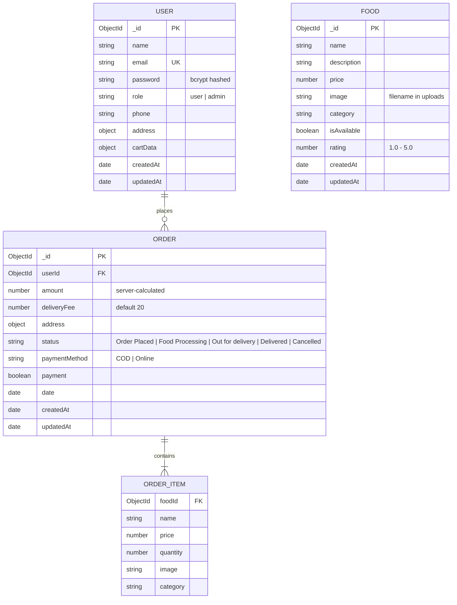

# 🍔 FoodPrep – Modern Full-Stack Food Ordering Platform

[](https://react.dev/)
[](https://nodejs.org/)
[](https://expressjs.com/)
[](https://www.mongodb.com/)
[](https://vitejs.dev/)

> A full-stack culinary commerce and food management platform engineered with modern React, Express 5, and MongoDB Atlas. FoodPrep delivers a high-performance customer ordering portal alongside an administrative back-office dashboard for complete menu, inventory, and order fulfillment control.

---

## 📑 Table of Contents

- [1. Project Overview](#1-project-overview)
- [2. Project Preview](#2-project-preview)
- [3. Key Features](#3-key-features)
  - [Customer Portal Features](#customer-portal-features)
  - [Administrator Dashboard Features](#administrator-dashboard-features)
  - [Backend & Core Engine Features](#backend--core-engine-features)
- [4. Technology Stack](#4-technology-stack)
- [5. Project Architecture & Directory Structure](#5-project-architecture--directory-structure)
- [6. Application Workflow](#6-application-workflow)
- [7. Installation and Local Setup](#7-installation-and-local-setup)
- [8. Environment Variables](#8-environment-variables)
- [9. API Documentation](#9-api-documentation)
- [10. Database Structure](#10-database-structure)
- [11. Security Implementation](#11-security-implementation)
- [12. Deployment Architecture (Render + Atlas)](#12-deployment-architecture-render--atlas)
- [13. Testing & Verification](#13-testing--verification)
- [14. Future Improvements](#14-future-improvements)
- [15. Developer Information](#15-developer-information)
- [16. License](#16-license)
- [17. Contribution Guidelines](#17-contribution-guidelines)
- [18. Acknowledgements](#18-acknowledgements)

---

## 1. Project Overview

**FoodPrep** is an enterprise-ready, multi-application food ordering and delivery management system. The platform is decoupled into three primary subsystems:

1. **FoodPrep User Web App (`FoodPrep/`)**: A fast, mobile-first e-commerce interface where customers discover gourmet dishes, filter by dietary preferences, search dynamically across real-time menus, manage shopping carts with synchronized cloud storage, and place orders with end-to-end status tracking.
2. **Admin Back-Office App (`adminfrontend/`)**: A protected administration panel for restaurant operators to analyze business metrics, manage menu items, upload food imagery, toggle stock availability, and update fulfillment lifecycles in real time.
3. **Core REST API Service (`backend/`)**: A secure Express 5 and Mongoose backend providing role-based authentication, database persistence, server-side price verification, and transactional ordering logic.

---

## 2. Project Preview

> **Note on Visual Previews**: Screenshot assets can be placed in a `docs/screenshots/` folder when adding media to your GitHub repository. Below are preview placeholders for each major application view:

| View | Purpose | Status / Placeholder |
| :--- | :--- | :--- |
| **User Homepage & Hero** | Full-width food-themed hero banner with live search and trending cravings | `[Screenshot: docs/screenshots/user-homepage.png]` |
| **Interactive Food Menu** | Category filtering (Salads, Rolls, Pastas, Biryani) and dynamic sorting | `[Screenshot: docs/screenshots/menu-listing.png]` |
| **Shopping Cart View** | Persistent item quantity controls, delivery calculations, and checkout triggers | `[Screenshot: docs/screenshots/cart-view.png]` |
| **Order Placement** | Multi-field delivery address capture, payment mode selection, and submission | `[Screenshot: docs/screenshots/checkout-view.png]` |
| **Customer Order Tracking** | Visual status tracking: *Order Placed → Food Processing → Out for delivery → Delivered* | `[Screenshot: docs/screenshots/my-orders.png]` |
| **Admin Analytics Dashboard** | Financial KPIs, order distributions, active item tallies, and recent sales | `[Screenshot: docs/screenshots/admin-dashboard.png]` |
| **Admin Menu & Food Management** | Dish creation with Multer image uploads, price edits, and availability toggle | `[Screenshot: docs/screenshots/admin-food-list.png]` |
| **Admin Order Fulfillment** | Live customer order queue with instant status change dropdowns | `[Screenshot: docs/screenshots/admin-orders.png]` |

---

## 3. Key Features

### Customer Portal Features
- **User Registration & Login**: Email-based signup and login with client-side format checks and JWT persistence.
- **Dynamic Full-Width Hero**: Warm culinary gradient background with decorative food photography, live search input, quick cravings pills, and smooth navigation.
- **Backend-Connected Search**: Real-time filtering across dish titles, descriptions, and categories without page reloads.
- **Category Browsing**: Seamless selection between Salads, Rolls, Deserts, Sandwiches, Cakes, Pure Veg, Pastas, and Noodles.
- **Popular Dishes Showcase**: Instant showcase of customer-favorite dishes with one-click Add-to-Cart controls.
- **Multi-Factor Sorting**: Sort dishes by Recommended, Price (Low to High), Price (High to Low), or Rating.
- **Food Detail Modal**: Detailed popover with full description, dietary tag (Veg / Non-Veg), rating, and quick quantity counter.
- **Persistent Cloud & Local Cart**: State synchronization via `localStorage` with authenticated backend database persistence.
- **Order Placement & Address Management**: Comprehensive shipping capture including address, city, state, postal code, and phone.
- **Order History & Real-Time Tracking**: Visual order timeline with color-coded badges and item breakdowns.
- **User Profile Management**: In-app modal to review and update phone numbers and saved addresses.

### Administrator Dashboard Features
- **Dedicated Admin Authentication**: Segregated login endpoint verifying explicit `admin` role authorization.
- **Analytics Dashboard**: Aggregated financial metrics including gross sales volume, completed orders, pending processing, and top categories.
- **Dish Management**: Create new menu items with image uploads via Multer, descriptions, category assignments, and pricing.
- **Availability Toggle**: Mark items as in-stock or sold-out with instantaneous updates reflected on the customer frontend.
- **Item Deletion**: Remove obsolete dishes and purge corresponding image assets.
- **Fulfillment Operations**: Review customer delivery addresses, contact numbers, order items, and advance status (*Order Placed → Food Processing → Out for delivery → Delivered / Cancelled*).

### Backend & Core Engine Features
- **RESTful API Architecture**: Strict resource-oriented endpoints for Users, Food Items, Cart, and Orders.
- **Database Persistence**: MongoDB connection with Mongoose schemas, automated indexation, and timestamp tracking.
- **Role-Based Access Control (RBAC)**: Fine-grained token verification distinguishing standard users from administrative operators.
- **Server-Side Price Verification**: Zero trust on client prices. Order totals and item costs are strictly queried and computed from the database.
- **Image Upload Pipeline**: Multer storage engine with MIME-type and extension validation (JPEG, JPG, PNG, WEBP, GIF) and 5MB payload caps.
- **Automated Seeding**: Self-healing initialization that creates a default administrator and default menu catalog on cold starts if empty.

---

## 4. Technology Stack

Verified directly from the project's configuration files:

### Frontend (Customer App – `FoodPrep`)
| Technology | Version | Purpose |
| :--- | :--- | :--- |
| **React** | `^19.2.7` | Reactive component architecture |
| **React DOM** | `^19.2.7` | Web rendering engine |
| **React Router DOM** | `^7.18.1` | Client-side routing and navigation |
| **Vite** | `^8.1.1` | Next-generation frontend tooling and HMR bundler |
| **Oxlint** | `^1.71.0` | High-performance Rust-based JavaScript/React linter |
| **Vanilla CSS3** | — | Modern Flexbox, CSS Grid, custom properties, and keyframe animations |

### Admin Frontend (`adminfrontend`)
| Technology | Version | Purpose |
| :--- | :--- | :--- |
| **React** | `^19.2.7` | Administrative UI components |
| **React Router DOM** | `^7.18.2` | Single-page administrative route guards |
| **Axios** | `^1.20.0` | Promise-based HTTP client for API interactions |
| **React-Toastify** | `^11.1.0` | Non-blocking operator alert and status notifications |
| **Vite** | `^8.1.1` | Production build and development server |
| **Oxlint** | `^1.71.0` | Static code analysis |

### Backend Service (`backend`)
| Technology | Version | Purpose |
| :--- | :--- | :--- |
| **Node.js** | `>= 20.x` | Asynchronous JavaScript runtime environment |
| **Express** | `^5.2.1` | Minimalist HTTP server and routing engine |
| **Mongoose** | `^9.9.0` | MongoDB Object Data Modeling (ODM) layer |
| **jsonwebtoken** | `^9.0.3` | HMAC-SHA256 stateless session tokens |
| **bcryptjs** | `^3.0.3` | Cryptographic password hashing (10 salt rounds) |
| **Multer** | `^2.2.0` | Multipart/form-data handler for image uploads |
| **Cors** | `^2.8.6` | Cross-Origin Resource Sharing control |
| **Validator** | `^13.15.35` | String sanitation and email validation |
| **Dotenv** | `^17.4.2` | Environment configuration manager |
| **Stripe** | `^22.4.0` | Payment gateway integration client |
| **Nodemon** | `^3.1.14` | Development auto-reload monitor |

---

## 5. Project Architecture & Directory Structure

```text
project1/
├── FoodPrep/                     # Customer Frontend Application (React 19 + Vite)
│   ├── index.html                # Entry HTML shell
│   ├── package.json              # Client dependencies and scripts
│   ├── vite.config.js            # Vite bundler configuration
│   └── src/
│       ├── main.jsx              # React DOM initialization & router mounting
│       ├── App.jsx               # Root layout, modal managers, route declarations
│       ├── App.css               # Global application layout & container rules
│       ├── index.css             # Base CSS reset, typography, and theme variables
│       ├── assets/               # High-resolution food photography, logos, icons
│       │   ├── assets.js         # Centralized image imports & fallback catalogs
│       │   └── ...
│       ├── context/
│       │   └── StoreContext.jsx  # Global application state: cart, auth, search, food
│       ├── screens/
│       │   ├── Home/             # Homepage composing Hero, Categories, Grid, App strip
│       │   ├── Cart/             # Cart review, item quantity modifiers, order summary
│       │   ├── PlaceOrder/       # Delivery address inputs & order placement trigger
│       │   └── MyOrders/         # Customer historical orders & status progression
│       └── components/
│           ├── Header/           # Redesigned full-width hero with search & cravings
│           ├── Navbar/           # Sticky brand navigation, cart badge, auth dropdown
│           ├── ExploreMenu/      # Horizontal category selector
│           ├── PopularDishes/    # Curated popular dish showcase with instant Add
│           ├── FoodDisplay/      # Main menu grid, search filter, price sorting
│           ├── FoodCard/         # Individual dish card with veg indicator & counter
│           ├── FoodDetailModal/  # Modal inspection view for individual food items
│           ├── LoginPopup/       # Sign-in and registration overlay
│           ├── ProfileModal/     # Customer profile contact & address editor
│           ├── Toast/            # Custom floating toast notifications
│           └── Footer/           # Multi-column footer with developer details
│
├── adminfrontend/                # Back-Office Administrative Dashboard (React 19 + Vite)
│   ├── index.html                # Admin entry HTML shell
│   ├── package.json              # Admin dependencies and scripts
│   ├── vite.config.js            # Admin Vite configuration
│   └── src/
│       ├── main.jsx              # Entry mounting AdminContext and React Router
│       ├── App.jsx               # Admin auth gatekeeper and dashboard routing
│       ├── context/
│       │   └── AdminContext.jsx  # Admin token state, credentials, API client
│       ├── components/
│       │   ├── Navbar/           # Admin header with logout & operator profile
│       │   └── Sidebar/          # Navigation tabs (Dashboard, Add, List, Orders)
│       └── screens/
│           ├── Dashboard/        # Analytics KPIs, sales metrics, order counts
│           ├── Add/              # Multipart form for adding new dishes with image
│           ├── List/             # Table of all dishes with availability toggle & remove
│           ├── Orders/           # Real-time customer order queue & status editor
│           └── Login/            # Secure administrator sign-in portal
│
├── backend/                      # Core REST API Service (Node.js + Express 5)
│   ├── server.js                 # Server entry point, CORS, routing, DB bootstrap
│   ├── package.json              # Backend dependencies and scripts
│   ├── .env                      # Environment configuration (excluded from Git)
│   ├── uploads/                  # Storage directory for uploaded dish photos
│   ├── config/
│   │   └── dbConn.js             # Mongoose MongoDB Atlas connection handler
│   ├── models/
│   │   ├── userModel.js          # Customer & Administrator schema
│   │   ├── foodModel.js          # Food dish schema with price, rating, category
│   │   └── orderModel.js         # Customer order schema with server-verified items
│   ├── controllers/
│   │   ├── userController.js     # Register, login, admin authentication, profiles
│   │   ├── foodController.js     # Add, list, update, remove food dishes & seeding
│   │   ├── cartController.js     # Add, decrement, fetch, clear customer carts
│   │   └── orderController.js    # Place order, price calculation, status, metrics
│   ├── middlewares/
│   │   └── auth.js               # JWT verification & role-based admin guard
│   └── routes/
│       ├── userRouter.js         # Routes for /api/user/*
│       ├── foodRouter.js         # Routes for /api/food/*
│       ├── cartRouter.js         # Routes for /api/cart/*
│       └── orderRouter.js        # Routes for /api/order/*
│
├── .gitignore                    # Root ignore file (node_modules, .env, dist, uploads)
└── README.md                     # Comprehensive repository documentation
```

---

## 6. Application Workflow

The complete end-to-end data lifecycle across FoodPrep:

```
[Customer Frontend: FoodPrep]
     │
     ├── 1. Registration / Login ───> [POST /api/user/login] ───> (JWT Token Generated)
     │
     ├── 2. Explore Menu & Search ──> [GET /api/food/list] ────> (Dishes fetched from MongoDB)
     │
     ├── 3. Add to Shopping Cart ───> [POST /api/cart/add] ────> (Stored in MongoDB user.cartData)
     │
     ├── 4. Checkout & Address ─────> [POST /api/order/place]
     │                                     │
     │                                     ▼
     │                       [Backend Security Layer]
     │                       - Ignores client prices
     │                       - Queries MongoDB for real prices
     │                       - Verifies food.isAvailable
     │                       - Computes verified total & fee
     │                       - Persists new Order document
     │                       - Empties customer cartData
     │                                     │
     ▼                                     ▼
[User: Track Order]                [MongoDB Database]
(GET /api/order/userorders)                │
- "Order Placed"                           │ Live order synced
- "Food Processing"                        ▼
- "Out for delivery"            [Admin Dashboard: adminfrontend]
- "Delivered"                  (GET /api/order/list & metrics)
     ▲                                     │
     │                                     │ Admin advances status
     └────────── Status Updated ───────────┘ (POST /api/order/status)
```

---

## 7. Installation and Local Setup

### Prerequisites
- **Node.js**: `v20.x` or higher installed ([Download Node.js](https://nodejs.org/))
- **npm**: `v10.x` or higher
- **MongoDB**: A free cloud cluster on [MongoDB Atlas](https://www.mongodb.com/atlas) or a locally running MongoDB daemon on `mongodb://localhost:27017`

### Step 1: Clone the Repository
```bash
git clone https://github.com/Muzammil4464/project1.git
cd project1
```

### Step 2: Configure Backend Environment
Navigate into the `backend/` directory and create your `.env` file:
```bash
cd backend
touch .env   # On Windows: New-Item .env
```
Populate `.env` with your credentials (see [Section 8: Environment Variables](#8-environment-variables)):
```ini
PORT=4000
DB_URI=mongodb+srv://<username>:<password>@cluster0.xxxxx.mongodb.net/FoodPrep
JWT_TOKEN_SECRET=your_super_secret_jwt_key_here
ADMIN_EMAIL=admin@foodprep.com
ADMIN_PASSWORD=Admin@12345
CLIENT_URL=http://localhost:5173
ADMIN_URL=http://localhost:5174
NODE_ENV=development
```

### Step 3: Install Dependencies
Open three separate terminal tabs for each subsystem:

```bash
# Terminal 1: Backend API
cd backend
npm install

# Terminal 2: Customer Frontend
cd FoodPrep
npm install

# Terminal 3: Admin Back-Office
cd adminfrontend
npm install
```

### Step 4: Run the Development Servers

```bash
# Terminal 1: Start Backend (Runs on http://localhost:4000)
cd backend
npm run server    # or npm start

# Terminal 2: Start Customer Frontend (Runs on http://localhost:5173)
cd FoodPrep
npm run dev

# Terminal 3: Start Admin Frontend (Runs on http://localhost:5174)
cd adminfrontend
npm run dev
```

Open `http://localhost:5173` in your browser to experience the customer application, and `http://localhost:5174` to log into the administrator portal using `admin@foodprep.com` / `Admin@12345`.

---

## 8. Environment Variables

### Backend Configuration (`backend/.env`)

| Variable Name | Required | Default / Example Value | Description |
| :--- | :---: | :--- | :--- |
| `PORT` | Yes | `4000` | Port on which the Express server listens |
| `DB_URI` | Yes | `mongodb+srv://...` | Connection URI for MongoDB Atlas or local MongoDB instance |
| `JWT_TOKEN_SECRET` | Yes | `<64-character-hex-string>` | Cryptographic secret for signing and verifying JWT tokens |
| `ADMIN_EMAIL` | Optional | `admin@foodprep.com` | Email address for the automatically seeded default admin account |
| `ADMIN_PASSWORD` | Optional | `Admin@12345` | Initial password for the automatically seeded default admin account |
| `CLIENT_URL` | Optional | `http://localhost:5173` | Allowed origin for customer frontend in CORS policies |
| `ADMIN_URL` | Optional | `http://localhost:5174` | Allowed origin for admin frontend in CORS policies |
| `NODE_ENV` | Optional | `development` | Environment mode (`development` or `production`) |

### Customer Frontend (`FoodPrep/.env`)

| Variable Name | Required | Example Value | Description |
| :--- | :---: | :--- | :--- |
| `VITE_API_URL` | Optional | `http://localhost:4000` | Backend API base URL (defaults dynamically to `http://localhost:4000` in dev or Render in production) |

### Admin Frontend (`adminfrontend/.env`)

| Variable Name | Required | Example Value | Description |
| :--- | :---: | :--- | :--- |
| `VITE_API_URL` | Optional | `http://localhost:4000` | Backend API base URL for admin requests |

---

## 9. API Documentation

All routes are prefixed with `/api`. Authenticated endpoints require a custom `token` header containing a valid Bearer JWT.

### User APIs (`/api/user`)
| Method | Endpoint | Auth | Request Body | Description |
| :--- | :--- | :---: | :--- | :--- |
| `POST` | `/api/user/register` | Public | `{ name, email, password }` | Registers a new customer account |
| `POST` | `/api/user/login` | Public | `{ email, password }` | Authenticates customer & returns token |
| `POST` | `/api/user/admin-login` | Public | `{ email, password }` | Authenticates admin operator with role check |
| `GET` | `/api/user/profile` | User/Admin | None (`token` in header) | Retrieves profile of authenticated user |
| `POST` | `/api/user/update-profile`| User/Admin | `{ name, phone, address }` | Updates personal contact & address info |

### Food APIs (`/api/food`)
| Method | Endpoint | Auth | Request Type / Body | Description |
| :--- | :--- | :---: | :--- | :--- |
| `GET` | `/api/food/list` | Public | None | Returns list of all available food dishes |
| `GET` | `/api/food/item/:id` | Public | None | Returns details for a specific dish ID |
| `POST` | `/api/food/add` | Admin Only | `multipart/form-data` (image, name, price, description, category) | Adds a new food item to catalog |
| `POST` | `/api/food/update` | Admin Only | `multipart/form-data` or JSON (id, isAvailable, price, etc.) | Updates dish details or availability |
| `DELETE`| `/api/food/remove` | Admin Only | `{ id }` | Permanently deletes a food dish |

### Cart APIs (`/api/cart`)
| Method | Endpoint | Auth | Request Body | Description |
| :--- | :--- | :---: | :--- | :--- |
| `POST` | `/api/cart/add` | User | `{ itemId }` | Increments item quantity in user cart |
| `POST` | `/api/cart/remove` | User | `{ itemId }` | Decrements item quantity in user cart |
| `GET` | `/api/cart/get` | User | None | Fetches saved cart object for user |
| `POST` | `/api/cart/clear` | User | None | Empties customer cart |

### Order APIs (`/api/order`)
| Method | Endpoint | Auth | Request Body | Description |
| :--- | :--- | :---: | :--- | :--- |
| `POST` | `/api/order/place` | User | `{ items, address, paymentMethod }` | Verifies prices, computes total, and creates order |
| `GET` | `/api/order/userorders` | User | None | Retrieves order history for current customer |
| `GET` | `/api/order/list` | Admin Only | None | Retrieves all orders across the system |
| `POST` | `/api/order/status` | Admin Only | `{ orderId, status }` | Updates fulfillment status |
| `GET` | `/api/order/metrics` | Admin Only | None | Calculates financial and inventory analytics |

### Static Media Route
| Method | Endpoint | Auth | Description |
| :--- | :--- | :---: | :--- |
| `GET` | `/image/:filename` | Public | Static file server delivering images from `backend/uploads/` |

---

## 10. Database Structure

FoodPrep uses three primary schemas managed via Mongoose:



---

## 11. Security Implementation

- **Bcrypt Password Encryption**: User and administrator passwords are encrypted using `bcryptjs` with 10 salt rounds before persistence. Plaintext passwords are never stored.
- **Stateless JWT Sessions**: Authenticated sessions issue signed JSON Web Tokens (`HS256`) containing subject identity and access role with a 7-day expiration.
- **Dual-Layer Middleware Authorization**:
  - `authMiddleware`: Extracts the `token` header, validates signature against `JWT_TOKEN_SECRET`, and fetches the user identity from MongoDB.
  - `adminMiddleware`: Enforces `req.user.role === 'admin'`. Unauthorized requests receive an immediate `403 Forbidden` response.
- **Zero-Trust Server-Side Price Verification**:
  During `POST /api/order/place`, submitted item prices are discarded. The backend queries each dish by ID from MongoDB, verifies `food.isAvailable !== false`, computes line totals, and calculates the final balance server-side.
- **Upload File Validation**: Multer storage filters incoming files to allowed image extensions (`jpeg`, `jpg`, `png`, `webp`, `gif`) and limits payload size to 5MB.
- **Sanitized Input Checking**: Emails and registration credentials are validated with `validator.js` to protect against malformed injections.

---

## 12. Deployment Architecture (Render + Atlas)

FoodPrep is designed for seamless continuous deployment on **Render** backed by **MongoDB Atlas**:

```
[Customer Browser]               [Admin Operator]
        │                               │
        ▼                               ▼
[Render Static Site]           [Render Static Site]
   FoodPrep/                      adminfrontend/
(https://project1-zu0w...)      (https://project1-admin...)
        │                               │
        └───────────────┬───────────────┘
                        │ API calls
                        ▼
               [Render Web Service]
                     backend/
           (https://food-delivery-backend-5b6g...)
                        │
                        ▼
             [MongoDB Atlas Cloud DB]
                  Cluster0 (AWS)
```

### 1. User Frontend (`FoodPrep`) – Render Static Site
- **Build Command**: `npm install && npm run build`
- **Publish Directory**: `dist`
- **Redirects / Rewrites**:
  ```text
  /*    /index.html    200
  ```
  *(Ensures React Router client-side routing works smoothly upon browser refresh)*
- **Environment Variable**: `VITE_API_URL=https://<your-backend-service>.onrender.com`

### 2. Admin Frontend (`adminfrontend`) – Render Static Site
- **Build Command**: `npm install && npm run build`
- **Publish Directory**: `dist`
- **Redirects / Rewrites**:
  ```text
  /*    /index.html    200
  ```
- **Environment Variable**: `VITE_API_URL=https://<your-backend-service>.onrender.com`

### 3. Backend API (`backend`) – Render Web Service
- **Runtime**: Node
- **Build Command**: `npm install`
- **Start Command**: `node server.js`
- **Environment Variables**:
  ```ini
  NODE_ENV=production
  PORT=4000
  DB_URI=mongodb+srv://<user>:<pwd>@cluster0.xxxxx.mongodb.net/FoodPrep
  JWT_TOKEN_SECRET=<strong-random-key>
  CLIENT_URL=https://<user-site>.onrender.com
  ADMIN_URL=https://<admin-site>.onrender.com
  ```

---

## 13. Testing & Verification

Automated unit/integration test suites are currently planned for a future milestone (see [Section 14](#14-future-improvements)). The application has been verified through end-to-end manual and static procedures:

### Static Verification
- **Frontend Syntax & Compilation**:
  ```bash
  npm --prefix FoodPrep run build
  npm --prefix adminfrontend run build
  ```
  Both builds produce optimized production bundles without warnings or bundle errors.
- **Code Linting**:
  ```bash
  npm --prefix FoodPrep run lint
  npm --prefix adminfrontend run lint
  ```

### Functional Verification Checklist
1. **Hero & Search**: Search bar updates `searchQuery`, filters menu instantly, and smoothly scrolls to `#food-display`.
2. **Category Navigation**: Clicking category circles filters the food grid dynamically.
3. **Cart Operations**: Adding, decrementing, and clearing cart items updates badges in real time and synchronizes with local storage and MongoDB.
4. **Checkout & Price Calculation**: Placing an order sends verified address details and triggers backend price calculations.
5. **Admin Operations**: Authenticating as admin allows adding new items with image uploads and toggling order delivery status.

---

## 14. Future Improvements

The following capabilities are planned for upcoming releases:

- [ ] **Automated Test Suite**: Implementing integration test suites using Jest, Supertest, and Cypress for end-to-end regression validation.
- [ ] **Live Payment Gateway**: Activating full Stripe / Razorpay checkout webhooks for instantaneous online card transactions.
- [ ] **Real-Time WebSockets**: Integrating Socket.IO for push-based order status updates without polling.
- [ ] **Driver Delivery App**: Dedicated mobile interface for delivery partners with GPS geolocation tracking.
- [ ] **Push Notifications**: Web push alerts notifying customers when food status changes to *Out for delivery*.
- [ ] **Customer Reviews & Photos**: Allowing verified buyers to submit dish ratings, text reviews, and meal photos.

---

## 15. Developer Information

Crafted and maintained with precision by:

- **Developer**: **Muzammil Shaik**
- **Telephone**: [+91 9177895782](tel:+919177895782)
- **Email**: [muzammilshaik1525p@gmail.com](mailto:muzammilshaik1525p@gmail.com)
- **LinkedIn**: [Muzammil Shaik on LinkedIn](https://linkedin.com)
- **GitHub**: [@Muzammil4464](https://github.com/Muzammil4464)

---

## 16. License

This repository does not currently contain a standalone root `LICENSE` file. Licensing terms can be added in a future release (such as the MIT or ISC license). All rights are currently reserved by the author.

---

## 17. Contribution Guidelines

Contributions, issues, and feature requests are welcome!

1. Fork the Project repository.
2. Create your Feature Branch (`git checkout -b feature/AmazingFeature`).
3. Commit your changes (`git commit -m 'feat: Add some AmazingFeature'`).
4. Push to the Branch (`git push origin feature/AmazingFeature`).
5. Open a Pull Request with a clear description of your changes.

---

## 18. Acknowledgements

- Built with modern open-source technologies: [React](https://react.dev/), [Node.js](https://nodejs.org/), [Express](https://expressjs.com/), [MongoDB](https://www.mongodb.com/), and [Vite](https://vitejs.dev/).
- Design inspiration drawn from industry-leading food delivery platforms (such as Swiggy and Zomato) for clean UI patterns and full-width culinary hero banners. *(FoodPrep is an independent project and is not affiliated with, endorsed by, or sponsored by Swiggy or Zomato).*
- Special thanks to the open-source community for providing high-performance tools and libraries.
